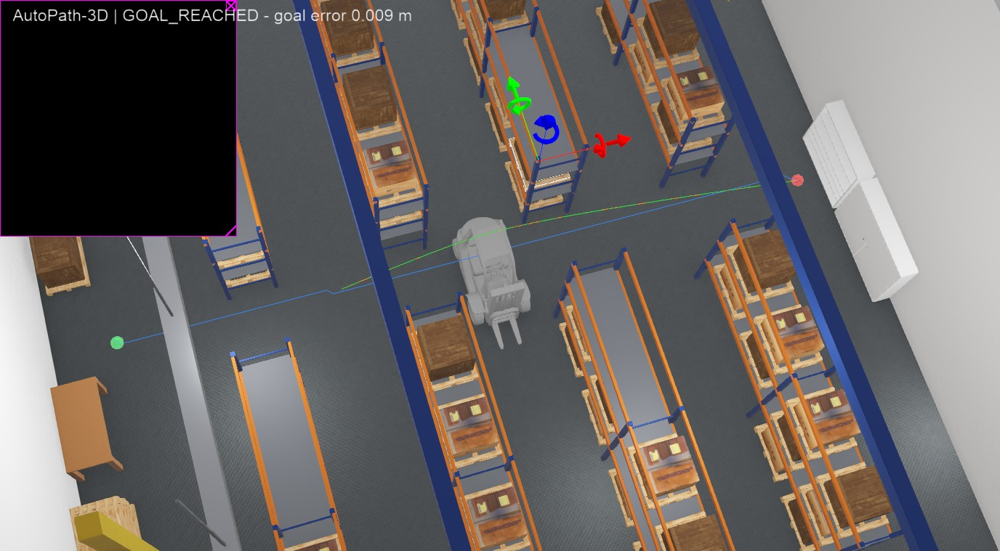
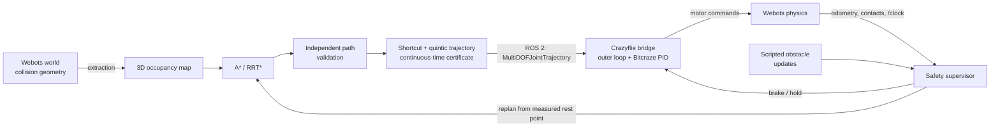

# AutoPath-3D — Autonomous 3D Motion Planning and Drone Navigation with ROS 2 & Webots

AutoPath-3D uses 3D A* or RRT* to search a known occupancy map, checks the resulting path,
and fits a time-parameterized quintic trajectory. A ROS 2 Jazzy stack sends the reference to
a simulated Crazyflie in Webots. The warehouse trials include navigation, braking and
replanning around a forklift, holding when no route exists, and an unsafe stop that ends in
contact. All flight results are from physics simulation.

<p align="center">
  
</p>
<p align="center"><sub>Genuine frame rendered by the Webots R2025a simulator, exported by the AutoPath scene
manager at the end of a Demo B run. The forklift has moved into the cross aisle, blocking the
original path (blue), and the simulated drone has reached its goal along the replanned path. The overlay shows
the end state of <em>that</em> run (goal error 0.009 m). It is not the archived Demo B run reported
under <a href="#evaluation">Evaluation</a> (0.057 m). Webots models and textures © Cyberbotics Ltd.,
under the Webots asset terms (<a href="THIRD_PARTY_NOTICES.md">third-party notices</a>).</sub></p>

**Contents:** [Overview](#overview) · [Architecture](#architecture) · [Features](#technical-features) ·
[Evaluation](#evaluation) · [Reproducing](#reproducing-the-results) · [Limitations](#limitations) ·
[Licensing](#licensing-and-attribution)

## Overview

All planning, verification, trajectory, supervision and integration code in this repository was
written for this project:

- 3D occupancy grid with FREE / OCCUPIED / UNKNOWN space, and an exact cube-distance clearance
  field;
- certified point, segment and path collision checks for a spherical robot envelope;
- 3D A* and RRT*;
- an independent path validator;
- collision-aware shortcutting and piecewise-quintic trajectory generation, with continuous-time
  certification;
- a stopping-distance model and a stop-and-replan supervisor;
- a conservative, disturbance-aware stopping assessment;
- a point-mass closed-loop simulator and a Rerun viewer;
- six ROS 2 nodes;
- two Webots driver plugins (the Crazyflie trajectory-tracking bridge and the scene-manager
  supervisor);
- a deterministic warehouse-world generator and a collision-geometry extractor;
- unit, offline-integration and end-to-end tests.

Third-party components are used, not reimplemented: Webots R2025a and its PROTO models,
`webots_ros2` and the Bitcraze Crazyflie PID flight controller (used unmodified), ROS 2 Jazzy,
NumPy and SciPy (`cKDTree`). See [Licensing](#licensing-and-attribution).

| Phase | Scope | Robot model |
|---|---|---|
| 1 | Geometric planning: A*, RRT*, independent validation, 7 synthetic scenes | 0.25 m sphere + 0.10 m margin |
| 2 | Shortcutting, certified quintic trajectories, stop-and-replan supervisor | same, + 0.10 m tracking allowance |
| 3 | Closed-loop point-mass simulation under wind gusts, Rerun viewer | translational double integrator |
| 4 | ROS 2 Jazzy + Webots R2025a warehouse, physics-simulated Crazyflie | Webots Crazyflie (0.10 m envelope) |

## Architecture



- **Core library** (`src/autopath3d`): pure Python and NumPy. It has no ROS dependency, and the
  ROS nodes call it unchanged.
- **ROS 2 package** (`ros2/autopath3d_ros`):
  - `map_node` builds the voxel map from the geometry extracted from the running world;
  - `planner_node` serves `nav_msgs/GetPlan` for A* and RRT*;
  - `trajectory_node` shortcuts, generates and certifies trajectories;
  - `supervisor_node` decides to brake, assesses the stop, and replans or holds;
  - `mission_node` runs and records scenarios.
- **Webots side:** the Crazyflie bridge tracks the trajectory through the Bitcraze PID, and the
  scene manager publishes `/clock`, ground truth and the scripted obstacle motions.
- **Process layout:** Webots runs on Windows; ROS 2 runs in WSL 2 (Ubuntu 24.04) and connects to
  Webots over TCP.

Details: [`docs/ARCHITECTURE.md`](docs/ARCHITECTURE.md) (core) and [`ros2/README.md`](ros2/README.md)
(nodes, topics, frames).

## Technical features

- **3D A\***: 6/18/26-connected search on the voxel lattice, with exact corner-cutting checks
  against the clearance field.
- **3D RRT\***: parent selection and rewiring, a goal bias and a fixed iteration budget. Seeds
  are recorded.
- **Independent collision verification**: every returned path is re-checked by a separate
  validator, against both ground-truth geometry and the voxel map. Segment certification is
  Lipschitz-based and conservative.
- **Collision-aware trajectory generation**:
  - shortcutting that only accepts certified segments;
  - piecewise-quintic (C²) trajectories, certified in continuous time for clearance, speed and
    acceleration;
  - a straight-line rest-to-rest fallback when a curved candidate fails certification.
- **Motion constraints**:
  - Phases 2–3: v ≤ 3 m/s, |a| ≤ 2 m/s²;
  - Phase 4: v ≤ 0.8 m/s, |a| ≤ 0.5 m/s², limits measured from the Crazyflie characterisation.
- **Drone trajectory tracking**: a feed-forward + PD outer loop on top of the unmodified
  Bitcraze velocity/altitude PID, with takeoff, hold, track, brake and land modes.
- **Safety supervision**:
  - an obstacle update is checked against the remaining trajectory with a continuous-time
    conflict certificate, and the drone brakes on a conflict;
  - a conservative stopping assessment bounds the stop under latency, disturbance and tracking
    error;
  - the stop is verified from the measured state;
  - the supervisor then replans from the measured rest point, or holds when no route exists.
- **ROS 2 communication**: standard interfaces throughout (`GetPlan`, `MultiDOFJointTrajectory`,
  `Odometry`, `Detection3DArray`, `PointCloud2`, TF and `/clock`) and simulation time.
- **Webots warehouse simulation**: a 20 × 16.4 m hall generated deterministically from the official
  `factory.wbt` sample, with racks, cargo, a forklift, a cage with a sliding gate, and real
  collision bodies. 662 collision records are extracted from the running world into the planning
  map.

## Evaluation

All numbers below are measured. They come from the summaries and reports linked in each subsection.
Phase 1–3 results come from deterministic synthetic scenes. Phase 4 results come from Webots
physics, and each scenario is a single recorded run, not a distribution.

### Phase 1 — geometric planning ([`results/phase1/summary.md`](results/phase1/summary.md))

Setup: 0.25 m sphere + 0.10 m margin (c = 0.35 m), 0.2 m voxels, A* 26-connected, RRT* 10k
iterations × 5 seeds.

- **Success:**
  - 9 feasible tasks in 5 scenes: A* 9/9 and RRT* 45/45 runs succeeded.
  - All 57 returned paths passed independent exact validation.
  - Minimum ground-truth clearance: 0.352 m.
- **Correct failure:** in `narrow_500` (a 0.5 m window, narrower than 2c) both planners report
  no path.
- **Lattice limitation:** in `narrow_900` A* finds no path at 0.2 m or 0.4 m resolution, while
  RRT* succeeds on 3/5 seeds at 0.2 m. A* searches the voxel-centre lattice, so a coarse
  lattice can miss a usable passage through the opening. RRT* samples continuous positions
  against the voxel collision model. A* succeeds when the lattice is refined to 0.1 m.
- **Path length:** RRT* is shorter than A* on 6/9 tasks and longer on both `urban_canyon` tasks.
- **Planning time (pure Python):** A* 0.01–17 s, RRT* 3.4–6.9 s.

### Phase 2 — trajectories and replanning ([`results/phase2/summary.md`](results/phase2/summary.md))

Setup: trajectory clearance 0.45 m (0.35 m nominal + 0.10 m tracking allowance), v ≤ 3 m/s,
|a| ≤ 2 m/s².

- **Trajectories:** 18/18 feasible pipelines produced independently validated C² trajectories:
  - max speed ≤ 2.910 m/s;
  - max |a| ≤ 1.940 m/s²;
  - min clearance ≥ 0.452 m.

  The 4 `narrow_900`/`narrow_500` pipelines fail at the planning stage.
- **Phase 1 paths reused directly:** only 14/57 remain valid at 0.45 m. The other 43 are rejected,
  not smoothed.
- **Replanning scenarios:** 7/7 match the expected outcome. This includes the negative cases:
  - no route → hold;
  - unavoidable collision;
  - safety-margin violation.

### Phase 3 — point-mass closed loop ([`results/phase3/summary.md`](results/phase3/summary.md))

Setup: double integrator, FF + PD, deterministic gusts (|d| ≤ 0.42 m/s²).

- **Navigation:** 36/36 runs reached the goal with 0 collisions.
  - Gusts: max position error 0.033 m; min executed clearance 0.452 m.
- **Scenarios:** under gusts, scenario **D2 degraded from a margin violation to a grazing contact**
  (0.3 mm into the sphere at 0.22 m/s). The cause was the supervisor's braking prediction, which
  ignores wind. This is reported as a failed run, and it motivated the Phase 4 conservative
  assessment.

### Phase 4 — ROS 2 + Webots physics ([`docs/PHASE4_REPORT.md`](docs/PHASE4_REPORT.md))

Crazyflie clearances:
- nominal 0.20 m (0.10 m envelope + 0.10 m margin);
- trajectory 0.37 m (adds a 0.17 m tracking allowance);
- minimum clearance in the table = drone centre to the extracted collision geometry.

| Demo | Scenario | Planner | Outcome | Collisions | Min clearance | Tracking max |
|---|---|---|---|---|---|---|
| A | staging area → mezzanine (22.4 m, climb to 3.9 m) | A* | GOAL_REACHED | 0 | 0.430 m | 0.132 m |
| A2 | around the rack rows (19.1 m) | RRT* | GOAL_REACHED | 0 | 0.449 m | 0.075 m |
| B | forklift enters the aisle ahead | A* | brake → safe stop → replan → GOAL_REACHED | 0 | 0.479 m | 0.078 m |
| C1 | cage gate closes | A* | brake → safe stop → no route → **hold** | 0 | 0.522 m | 0.040 m |
| C2 | load drops 0.55 m ahead at 0.77 m/s | A* | stop predicted unsafe → **physical contact** → abort | contact | 0.051 m | 0.019 m |

- **C2 is an intentional negative test.** Both the conservative assessment and the Phase 2
  prediction classified the stop as unsafe before contact, and Webots confirmed the contact.
  The number of separate contact events varies between runs (1–4).
- **Braking measured on the Crazyflie:**
  - deceleration onset 0.208 s after the brake command;
  - stop distance 0.26–0.50 m from 0.6–1.0 m/s.
- **Replanning time:**
  - Demo B: 2.43 s of simulation time from rest to the new trajectory;
  - A* proving that C1 has no route: 19.5 s (Python). The drone holds meanwhile.

**Automated tests**, re-run on 2026-11-11 for release preparation:

| Suite | Environment | Result |
|---|---|---|
| Core `tests/` | Windows, Python 3.13.4, NumPy 2.5.4, SciPy 1.18.1 | 112 passed |
| Core `tests/` | Ubuntu 24.04 / WSL 2, Python 3.12.3, NumPy 1.26.4, SciPy 1.11.4 | 108 passed, viewer tests skipped (no rerun-sdk) |
| ROS package, offline (`ros2/autopath3d_ros/test`) | Windows and WSL | 25 passed, 1 skipped (end-to-end is opt-in) |
| End-to-end Webots + ROS 2, A/B/C1/C2 | WSL + Windows Webots | 4/4 passed (330.7 s); the previous suite run, after the harness rewrite, was also 4/4 |
| End-to-end A2 (RRT*, fixed seed), bounded repeat | same | 3/3 passed, identical metrics in each run |

All 11 end-to-end sessions reached readiness, and none had a start-up failure. Records:
[`results/phase4/e2e/`](results/phase4/e2e/). This is limited repeatability evidence, not a
reliability statistic. The earlier start-up failures under the old harness are described in
[Limitations](#limitations).

## Reproducing the results

Tested configuration: Windows 11 with Python 3.13, plus WSL 2 Ubuntu 24.04 with ROS 2 Jazzy and
Webots R2025a installed on Windows. Linux-native Webots and macOS have not been tested.

### Standalone Python (no ROS)

Requirements: Python ≥ 3.11, with 3.12 and 3.13 tested. Dependencies: NumPy ≥ 1.26, SciPy ≥ 1.11,
PyYAML ≥ 6.0. The optional viewer needs `rerun-sdk==0.41.0`.

**Windows (PowerShell):**

```powershell
py -3.13 -m venv .venv
.venv\Scripts\python -m pip install -e ".[dev]"     # dev = pytest, matplotlib, rerun-sdk 0.41.0
.venv\Scripts\python -m pytest -q                   # core tests
.venv\Scripts\python scripts\run_phase1_benchmark.py    # writes results/phase1 (about 19 min)
.venv\Scripts\python scripts\run_phase2_evaluation.py   # writes results/phase2 (about 3 min)
.venv\Scripts\python scripts\run_phase3_simulation.py   # writes results/phase3 (about 3 min)
.venv\Scripts\python scripts\view.py --scenario warehouse_replan   # Rerun viewer on saved results
```

The benchmark scripts overwrite `results/`. Pass `--out <dir>` to keep the archived results.

**Ubuntu 24.04, using the distribution packages (the tested Linux route):**

```bash
sudo apt install python3-numpy python3-scipy python3-yaml python3-pytest
cd AutoPath-3D && PYTHONPATH=src python3 -m pytest -q tests    # test_viewer.py is skipped without rerun-sdk
```

### ROS 2 Jazzy + Webots R2025a (Windows + WSL 2)

1. Install **Webots R2025a** on Windows, in the default location `C:\Program Files\Webots`.
2. Install **Ubuntu 24.04** under WSL 2 with mirrored networking.
3. In WSL, clone the repository and install ROS 2 Jazzy, `webots_ros2_driver` and
   `webots_ros2_crazyflie`:

   ```bash
   git clone <repository-url> ~/autopath3d
   bash ~/autopath3d/ros2/setup/install_ros2_jazzy.sh        # apt; asks for sudo; size check first
   mkdir -p ~/ros2_ws/src && ln -sfn ~/autopath3d/ros2/autopath3d_ros ~/ros2_ws/src/autopath3d_ros
   source ~/autopath3d/ros2/env.sh
   cd ~/ros2_ws && colcon build --symlink-install && source ~/autopath3d/ros2/env.sh
   ```

   `env.sh` sets `PYTHONPATH` to the core library and points `WEBOTS_HOME` at the Windows Webots.
   It also applies two measured WSL workarounds: Fast DDS shared-memory transport only, and the
   Webots host `127.0.0.1`. Override `AP3D_ROOT`, `AP3D_WS` or `WEBOTS_HOME` before sourcing if your
   paths differ.

4. Run a demo. Each run starts Webots, flies the scenario, writes
   `~/autopath_results/<scenario>/run_<stamp>.json` and exits:

   ```bash
   ros2 launch autopath3d_ros warehouse.launch.py scenario:=A_navigation      # also: A2_around_racks,
   ros2 launch autopath3d_ros warehouse.launch.py scenario:=B_replan          #   C1_no_route, C2_unsafe_stop
   ```

5. Tests in WSL:

   ```bash
   source ~/autopath3d/ros2/env.sh && cd ~/autopath3d
   PYTEST_DISABLE_PLUGIN_AUTOLOAD=1 python3 -m pytest -q tests   # core; required once ROS is sourced (else 0 tests run)
   python3 -m pytest -q ros2/autopath3d_ros/test                   # ROS package, offline (no Webots)
   AUTOPATH_E2E=1 AUTOPATH_E2E_SCENARIOS=A_navigation,B_replan,C1_no_route,C2_unsafe_stop \
     python3 -m pytest -v ros2/autopath3d_ros/test/test_e2e_webots.py   # end-to-end, about 6 min
   ```

   The end-to-end harness runs one Webots at a time. It reports start-up failures separately
   from navigation failures, and it keeps logs under `~/autopath_e2e/`.

Troubleshooting and the full launch reference: [`ros2/README.md`](ros2/README.md).

## Limitations

- **Simulation only.** No real-world flight-safety claim of any kind is made.
- **Known map, not SLAM.** The map is the collision geometry extracted from the simulator. The
  core supports UNKNOWN space, but no sensor-based mapping is implemented.
- **Scripted obstacles, not perception.** Obstacle changes are scripted, and the Webots supervisor
  "detects" them with a fixed 0.2 s latency.
- **Limited test conditions.**
  - Webots: no wind and noise-free GPS.
  - The archived Webots numbers are single recorded runs. End-to-end repeats (2 suite runs; A2 3×
    with a fixed RRT* seed) reproduced the outcomes, but there are no statistical distributions,
    and only one RRT* seed was flown.
  - Phase 1–3 scenes are synthetic.
- **C2 physical contact.** The unsafe-stop demo ends in contact by design. The system predicts it
  but cannot avoid it.
- **Conservative A\* clearance rejection (unresolved in the core).**
  - At clearance thresholds that coincide with lattice distance values (for example c = 0.35 m at
    0.1 m resolution), A* accepts grid-centre paths whose clearance bound equals c exactly.
  - The later Lipschitz segment certificate cannot certify such edges, so the pipeline rejects the
    path. This fails safe: a safe path is rejected, and no unsafe path is accepted.
  - The shipped Webots configuration uses c = 0.37 m, which is not such a value, and a test guards
    this.
  - The general inconsistency is documented and covered by regression tests, but it is not fixed.
    See the [Phase 4 report](docs/PHASE4_REPORT.md) §7.3 for the diagnosis and regression checks.
- **Intermittent Webots start-up failure (origin unknown).**
  - With an earlier test harness, 4 of 7 Webots launches exited with code 5 about 1 s after
    start, without flying.
  - After the harness was rewritten, no recurrence has been observed. The root cause was never
    isolated, so it is not claimed to be fixed.
- **Performance.** A* is pure Python: replanning takes seconds (13–21 s for the 22 m Demo A route),
  so this is not a real-time replanner.
- **Platform.** The ROS/Webots setup is specific to Windows + WSL 2 (DDS transport and host
  workarounds).

## Licensing and attribution

| Material | Licence |
|---|---|
| AutoPath-3D source code, tests, scripts, configuration, documentation and results | **MIT** — [`LICENSE`](LICENSE) |
| `ros2/autopath3d_ros/worlds/autopath_warehouse.wbt` — modified Webots `factory.wbt` sample (Cyberbotics Ltd.) | **Apache-2.0** — [`LICENSES/Apache-2.0.txt`](LICENSES/Apache-2.0.txt), marked as modified |
| Webots PROTO models and textures (Crazyflie, Forklift, pallets, …) | **Webots asset terms** ("licensed for use only with Webots"); referenced by URL and downloaded by Webots at run time, **not included here** |
| Bitcraze `pid_velocity_fixed_height_controller` (MIT), `webots_ros2` (Apache-2.0), ROS 2, NumPy, SciPy | run-time dependencies, not redistributed |

Full map, including the Webots screenshot and the extracted geometry:
[`THIRD_PARTY_NOTICES.md`](THIRD_PARTY_NOTICES.md).

## Repository layout

| Path | Contents |
|---|---|
| `src/autopath3d/environments` | analytic primitives (box, vertical cylinder) and 7 deterministic scenes |
| `src/autopath3d/maps` | occupancy grid (FREE/OCCUPIED/UNKNOWN), exact cube-distance clearance field |
| `src/autopath3d/collision` | robot model, certified point/segment/path checks |
| `src/autopath3d/planners` | 3D A* (6/18/26), RRT* (parent selection + rewiring) |
| `src/autopath3d/trajectories` | shortcutting, piecewise-quintic trajectory generator |
| `src/autopath3d/replanning` | stopping-distance model, stop-and-replan supervisor, conservative stopping assessment |
| `src/autopath3d/simulation` | double-integrator model, FF+PD controller, safety monitor, navigation executive |
| `src/autopath3d/evaluation` | independent path and continuous-time trajectory validators |
| `src/autopath3d/viz` | Rerun recording and blueprint |
| `ros2/autopath3d_ros` | ROS 2 package: nodes, Webots plugins, launch, config, world, tests |
| `scripts/`, `configs/` | Phase 1–4 experiment scripts and configurations |
| `tests/` | core unit and integration tests |
| `results/` | measured results of all phases ([`results/README.md`](results/README.md)) |

## Documentation

- [`docs/PHASE4_REPORT.md`](docs/PHASE4_REPORT.md) — ROS 2 + Webots integration report
- [`docs/PHASES_1-3_DETAILS.md`](docs/PHASES_1-3_DETAILS.md) — detailed Phase 1–3 results,
  limitations and Rerun viewer usage
- [`docs/ARCHITECTURE.md`](docs/ARCHITECTURE.md) — conventions and core design
- [`results/README.md`](results/README.md) — what each result file is and how it was produced
- [`ros2/README.md`](ros2/README.md) — ROS 2 package: setup, launch arguments, nodes, troubleshooting
